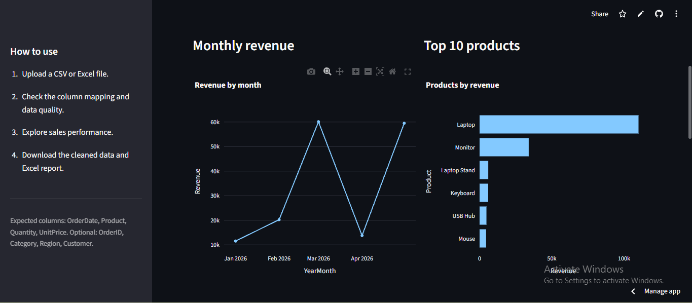

# 📊 Sales Data Automation Dashboard

A Python-based sales data cleaning, analysis, and reporting dashboard built using Streamlit.

🚀 **Live Demo:** https://sales-data-automation.streamlit.app/

## Dashboard Preview



## Features

- Upload sales data in CSV or Excel format.
- Automatically clean and validate sales records.
- Analyze total revenue, orders, and units sold.
- Explore monthly revenue trends.
- Identify top-performing products.
- Analyze regional sales performance.
- Download cleaned data as CSV.
- Export professional Excel reports with multiple sheets.

## Technologies Used

- Python
- Streamlit
- Pandas
- Plotly
- OpenPyXL

## Project Structure

```text
python-sales-data-automation/
│
├── app.py
├── requirements.txt
├── README.md
├── dashboard.png
│
└── data/
    └── sample_sales.csv
```

## Run Locally

Clone the repository:

```bash
git clone https://github.com/asif1702-pixel/python-sales-data-automation.git
```

Navigate to the project:

```bash
cd python-sales-data-automation
```

Install dependencies:

```bash
pip install -r requirements.txt
```

Run the application:

```bash
streamlit run app.py
```

## Sample Dataset Results

- Total Revenue: ₹165,200
- Valid Records: 15
- Units Sold: 33
- Average Revenue per Order: ₹11,013.33

## Author

**Asif Amaan**

M.Tech – VLSI & Nanoelectronics  
IIT Guwahati

---

If you find this project useful, consider giving the repository a ⭐.
